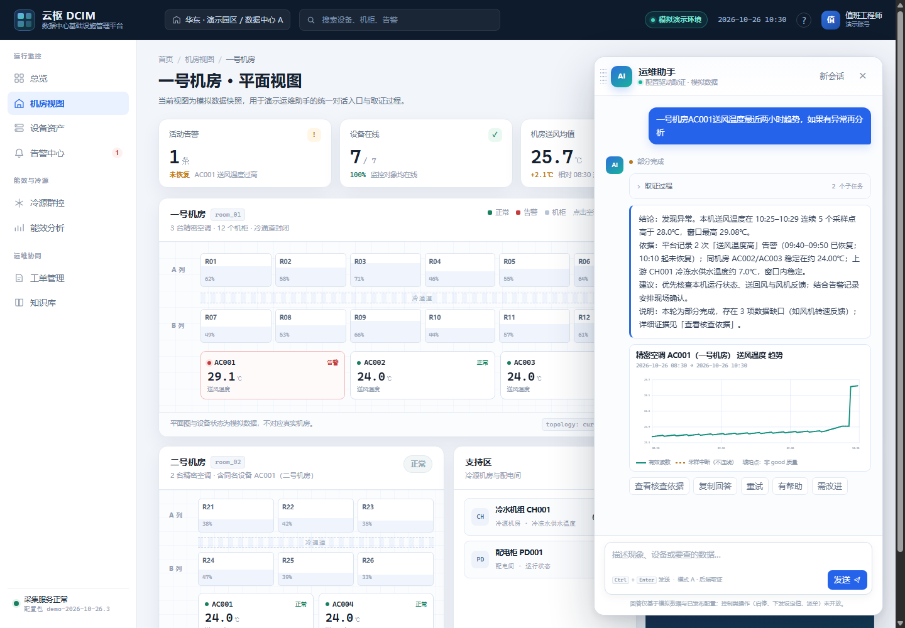
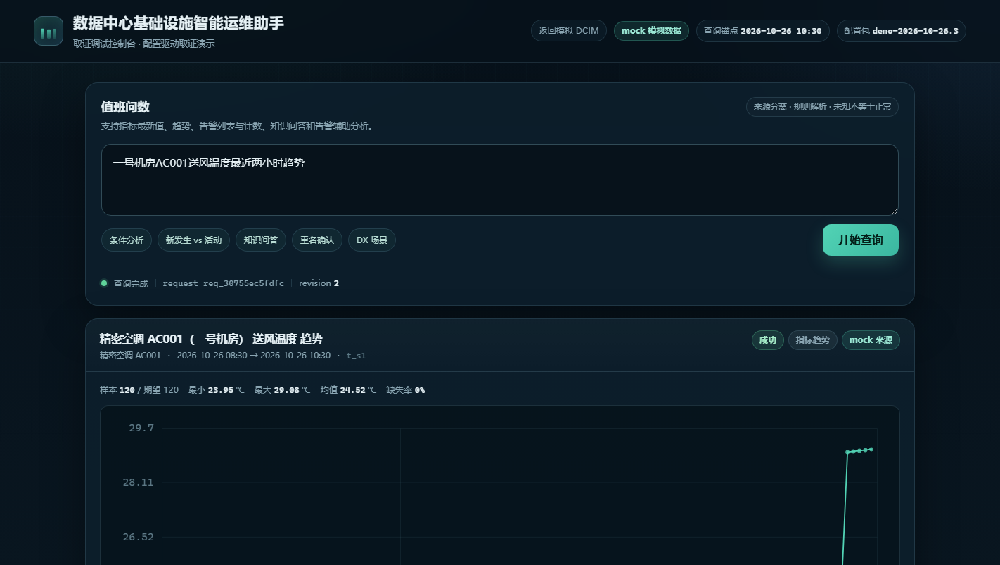
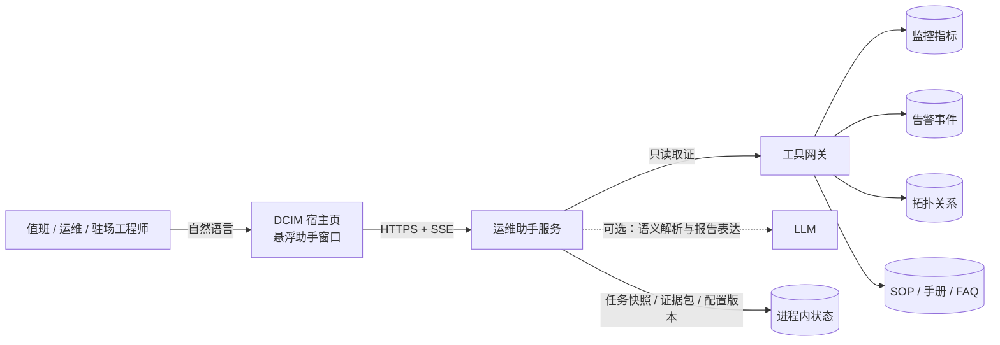
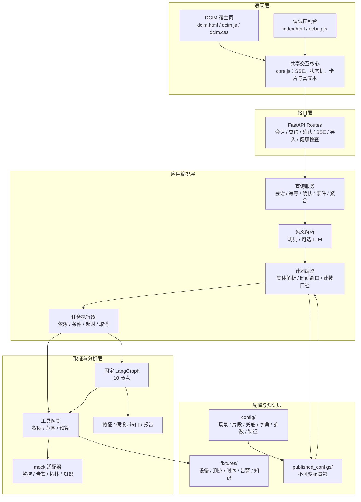
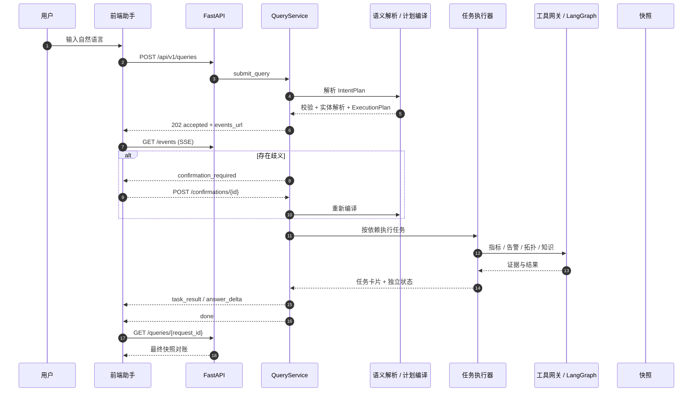
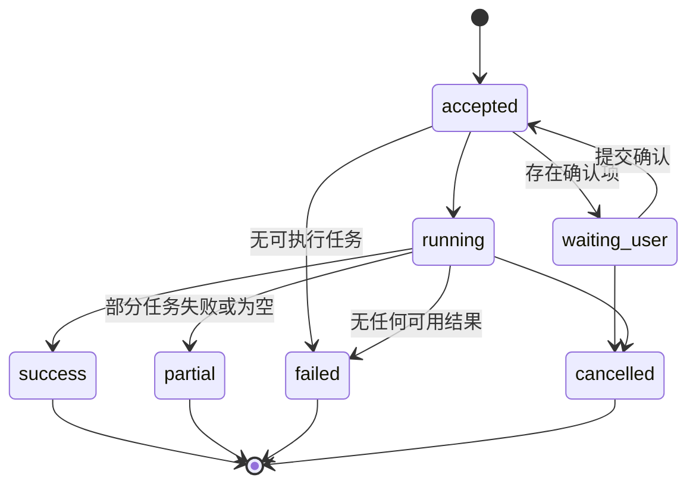
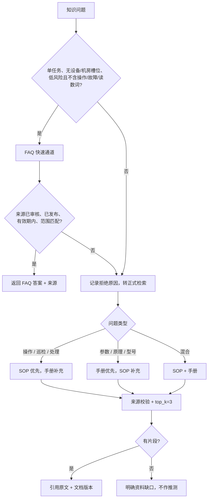
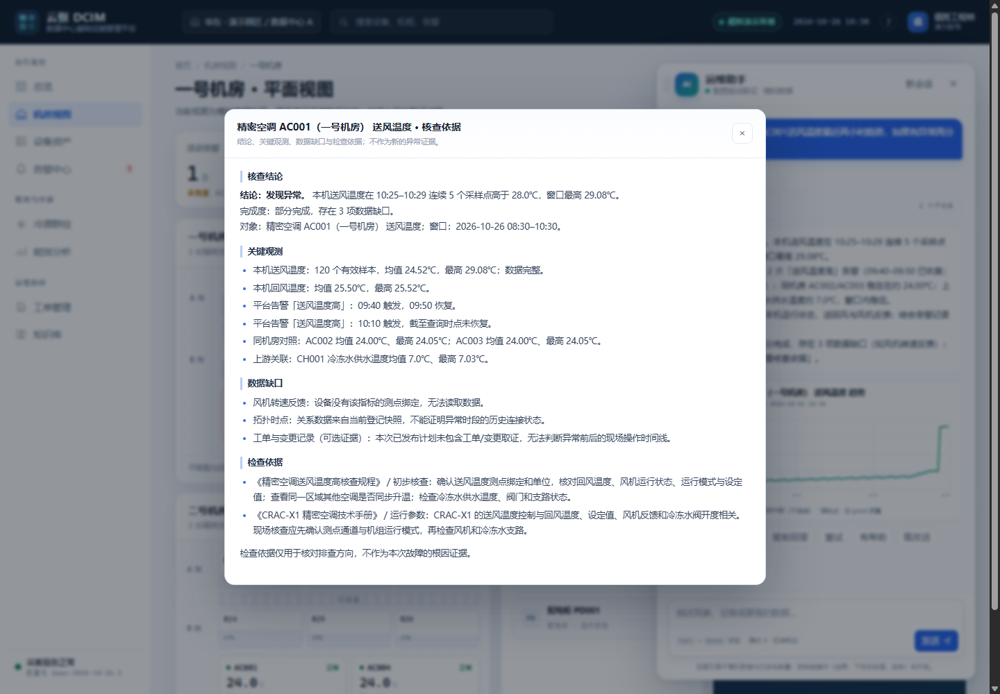

# 数据中心基础设施智能运维助手

**系统规格与架构说明（System Design Document）**

> 版本 `1.3.1` · 演示配置包 `demo-2026-10-26.3` · 数据源 `mock` · 自动化测试 `32 passed`

面向数据中心值班工程师、运维工程师与驻场人员的自然语言运维入口。系统把“问数、查告警、做辅助分析、查规程”收敛到同一个对话入口，并以**配置驱动取证**的方式约束模型的执行权限：模型只负责语义解析与表达，取证步骤、工具调用、拓扑查询和指标采集全部由后端读取已发布配置展开执行。

本 README 是仓库的唯一技术规格说明，覆盖产品边界、领域契约、执行链路、配置治理、接口、测试与部署。仓库不依赖外部设计文档即可独立阅读与运行。

---

## 目录

- [1. 文档定位](#1-文档定位)
- [2. 产品形态与系统上下文](#2-产品形态与系统上下文)
- [3. 设计原则与不可违背约束](#3-设计原则与不可违背约束)
- [4. 总体架构](#4-总体架构)
- [5. 领域模型与数据契约](#5-领域模型与数据契约)
- [6. 执行链路与状态机](#6-执行链路与状态机)
- [7. 告警辅助分析](#7-告警辅助分析)
- [8. 知识检索与资料治理](#8-知识检索与资料治理)
- [9. 时间、告警计数与数据质量](#9-时间告警计数与数据质量)
- [10. 配置即代码与发布治理](#10-配置即代码与发布治理)
- [11. 接口设计](#11-接口设计)
- [12. 身份、权限与安全](#12-身份权限与安全)
- [13. 前端产品形态与交互](#13-前端产品形态与交互)
- [14. 可观测性与运行保障](#14-可观测性与运行保障)
- [15. 测试与验收](#15-测试与验收)
- [16. 运行与部署](#16-运行与部署)
- [17. 已知限制](#17-已知限制)
- [18. 目录结构](#18-目录结构)
- [附录 A：演示数据与配置清单](#附录-a演示数据与配置清单)
- [附录 B：示例问题与预期行为](#附录-b示例问题与预期行为)
- [附录 C：术语表](#附录-c术语表)
- [附录 D：维护约定](#附录-d维护约定)

---

## 1. 文档定位

### 1.1 目的

本文档回答四个问题：

1. **系统做什么**：面向哪些角色、支持哪些问法、输出什么结果、明确不做什么。
2. **系统如何保证正确**：模型与后端的权责边界、事实分级、时间口径、部分成功语义。
3. **系统如何演进**：证据计划如何以配置发布，旧任务如何保持可回放。
4. **系统如何验收**：接口契约、状态机、测试矩阵与运行基线。

### 1.2 读者

| 读者 | 关注重点 |
| --- | --- |
| 值班 / 运维工程师 | 支持的问题类型、结果可信度、确认与取消方式 |
| 驻场交付工程师 | 部署方式、配置包、演示数据、已知限制 |
| 后端 / 平台开发者 | 领域契约、执行链路、工具网关、发布流水线 |
| 知识维护人员 | 资料准入、FAQ 快速通道、导入与审核边界 |
| 评审人员 | 设计不变量、失败语义、测试证据 |

### 1.3 范围与非目标

**首版范围**

- 精密空调送风温度异常与机房温度排查。
- 监控指标最新值、趋势查询。
- 告警列表、告警计数、有限场景的告警辅助分析。
- SOP / 手册 / FAQ 知识问答。
- Markdown / TXT 资料导入与待审核登记。
- 对话式澄清、确认、取消、幂等提交、SSE 过程流与最终快照对账。

**非目标**

- 不连接真实 DCIM、监控、告警或工单系统；当前只提供 mock 适配器。
- 不执行任何控制类操作：启停、倒闸、投退、设定值下发、派单等一律拒绝。
- 不实现模式 B：模型不得自由选择工具、自由编排取证步骤或自主扩大查询范围。
- 不提供生产级多租户、持久化、审计归档、跨实例事件总线与资料审核发布页面。

### 1.4 版本基线

| 项目 | 值 |
| --- | --- |
| 应用版本 | `1.3.1` |
| 语义契约 | `semantic-plan/0.5` |
| 证据配置契约 | `evidence-config/1` |
| 运行配置包 | `demo-2026-10-26.3` |
| 业务时区 | `Asia/Shanghai` |
| 演示固定时钟 | `2026-10-26T10:30:00+08:00` |
| 数据来源模式 | `mock` |
| 测试基线 | `32 passed` |

---

## 2. 产品形态与系统上下文

### 2.1 产品主张

运维助手不是独立的聊天网站，而是**悬浮在 DCIM 工作台上的助手窗口**。工程师在查看机房平面、设备状态和告警列表时，可以直接用自然语言追问当前对象，不需要复制设备编码、切换系统或重新组织查询条件。

首版刻意保持“有限能力 + 强约束”：

- 只读，不控制。
- 只回答有证据的问题，缺口显式暴露。
- 不把“没查到”说成“正常”。
- 不把用户口述直接当成故障结论。
- 不把知识文档当成某台设备当前故障的证据。

### 2.2 页面与入口

| 路径 | 页面 | 用途 |
| --- | --- | --- |
| `/` | 模拟 DCIM 宿主页 | 产品主形态：机房总览 + 悬浮助手窗口 |
| `/dcim` | 同上 | 显式入口，便于演示与书签 |
| `/debug` | 调试控制台 | 查看任务卡片、证据包、配置版本与原始过程 |
| `/docs` | OpenAPI | FastAPI 自动生成的接口文档 |
| `/api/v1/health` | 健康检查 | 时钟、配置版本、数据源模式、LLM 状态 |

模拟宿主页使用虚构品牌“云枢 DCIM”，仅用于呈现产品形态；页面中的设备、告警、指标与工单均来自 `fixtures/`，不代表任何真实平台。

**界面预览**



*模拟 DCIM 宿主页：左侧为机房与设备态势，右侧悬浮窗为配置驱动取证的助手。*



*调试控制台：固定时钟、配置版本、任务卡片与指标趋势。*

### 2.3 系统上下文



### 2.4 角色与权限

| 角色 | 主要操作 | 数据范围 |
| --- | --- | --- |
| 值班工程师 | 问数、查告警、查看分析、确认歧义对象 | 所属站点只读 |
| 运维工程师 | 同上，并查看证据包与检查建议 | 所属站点只读 |
| 知识维护人员 | 导入资料、维护 FAQ 与 SOP | 所属站点知识库 |
| 平台管理员 | 发布配置包、查看运行状态 | 租户级 |

演示环境使用固定身份 `user_demo` / `tenant_demo` / `mock-platform-01` / `site_01`。生产环境必须由认证依赖注入访问上下文，不能由模型或请求体扩大范围。

---

## 3. 设计原则与不可违背约束

### 3.1 模式 A 与模式 B

| 维度 | 模式 A：配置驱动取证（本实现） | 模式 B：模型自由规划（不实现） |
| --- | --- | --- |
| 谁决定取证步骤 | 已发布 YAML 证据计划 | 模型临时决定 |
| 谁选择工具 | 后端计划编译器 + 工具网关 | 模型自由选择 |
| 谁生成业务 ID | 后端实体解析 | 模型可能生成 |
| 可回放性 | 固定 `bundle_version` + `plan_hash` | 难以复现 |
| 风险边界 | 步骤、预算、范围可静态审计 | 依赖运行时约束 |
| 模型失败时 | 回退规则解析与模板报告 | 计划不可执行 |

模式 A 的核心不是“不用模型”，而是**模型不拥有执行权**。模型可以提出语义候选，但不能决定查什么、查多少、查多久、查哪些设备。

### 3.2 模型能力边界

| 模型可以做 | 模型不可以做 |
| --- | --- |
| 把自然语言解析为 `IntentPlan` 候选 | 生成 `asset_id`、`point_id`、`alarm_type_id`、`task_id` |
| 在受限范围内改写知识检索 query | 自由调用工具或新增取证步骤 |
| 基于已生成的证据包组织报告表达 | 修改证据、阈值、场景优先级或时间窗口 |
| 在解析失败时被规则解析器替代 | 把缺失数据补成 0、正常或“无异常” |

### 3.3 不变量清单

| 编号 | 不变量 | 落地位置 |
| --- | --- | --- |
| I-01 | 只允许配置驱动取证，禁止模式 B | `app/scenarios/registry.py`、`app/services/plan_compiler.py`、`app/graphs/analysis_graph.py` |
| I-02 | `IntentPlan` 只是候选，必须经后端校验、实体解析与计划编译 | `app/services/semantic_parser.py`、`app/services/plan_compiler.py` |
| I-03 | 模型不生成真实业务 ID | `app/schemas/intent.py` 禁止额外字段；实体解析由后端完成 |
| I-04 | 所有告警分析共用一张固定 LangGraph | `app/graphs/analysis_graph.py` |
| I-05 | 来源状态严格分级，用户口述不等于故障 | `app/schemas/analysis.py`、`app/evidence/report.py` |
| I-06 | `unknown` 不等于正常，缺失数据不填 0 | `app/evidence/features.py`、`app/services/alarm_count.py` |
| I-07 | 子任务独立状态，部分成功不清空成功结果 | `app/services/query_service.py`、`app/services/task_executor.py` |
| I-08 | 统一 Asia/Shanghai 与半开区间 `[start, end)` | `app/services/time_windows.py`、`app/schemas/execution.py` |
| I-09 | 新发生、当前活动、窗口内恢复三套口径分离 | `app/services/alarm_count.py` |
| I-10 | FAQ / SOP / 手册分开路由，知识只作检查依据 | `app/services/knowledge_service.py` |
| I-11 | 配置发布不可变，任务固定启动时配置版本 | `app/scenarios/config_publisher.py` |
| I-12 | 不执行控制类操作 | `app/services/semantic_parser.py`、`app/tools/gateway.py` |

### 3.4 来源状态与事实等级

| 来源类型 | 状态 | 含义 | 使用规则 |
| --- | --- | --- | --- |
| `user_statement` | `unverified` | 用户口述的异常或背景 | 只能作为待核实线索，不能直接写成故障 |
| `platform_alarm` | `reported_by_platform` | 平台上报的告警 | 可陈述“平台报告了该告警”，不自动等于后端确认异常 |
| `backend_evaluation` | `confirmed_abnormal` | 后端基于有效数据与规则确认异常 | 可作为结论，但必须附证据与参数 |
| `backend_evaluation` | `confirmed_normal` | 后端基于有效数据确认正常 | 必须有足够样本、覆盖率和明确阈值 |
| `backend_evaluation` | `unknown` | 数据不足、质量不合格或无法判断 | 必须显式展示缺口，不能写成正常 |

补充规则：

- 数据缺失、样本不足、时间覆盖不足、质量不合格时，一律输出 `unknown`。
- `unknown` 不是 `normal`，也不是 `abnormal`；报告中必须单独列出。
- 拓扑为当前快照，历史拓扑变化不在首版范围；分析结果会带 `topology_snapshot_is_current_only` 警告。

---

## 4. 总体架构

### 4.1 分层视图



### 4.2 模块职责

| 模块 | 文件 | 职责 |
| --- | --- | --- |
| 应用入口 | `app/main.py` | 创建 FastAPI、注册异常处理、挂载前端页面 |
| 接口 | `app/api/routes.py` | HTTP / SSE 路由与请求响应模型 |
| 容器 | `app/container.py` | 构建服务、适配器、配置包与 LLM 客户端 |
| 语义解析 | `app/services/semantic_parser.py` | 规则解析、可选 LLM 解析、结构校验与回退 |
| 实体解析 | `app/services/entity_resolution.py` | 机房 / 设备 / 指标 / 告警类型解析与歧义候选 |
| 计划编译 | `app/services/plan_compiler.py` | 意图转执行计划、时间窗口、计数口径、确认项 |
| 查询服务 | `app/services/query_service.py` | 会话、幂等、确认、取消、任务调度、SSE、答案聚合 |
| 任务执行 | `app/services/task_executor.py` | 按依赖与条件执行子任务，维护独立状态 |
| 时间窗口 | `app/services/time_windows.py` | Asia/Shanghai、半开区间、相对时间解析 |
| 告警计数 | `app/services/alarm_count.py` | episode 去重与三类计数口径 |
| 知识服务 | `app/services/knowledge_service.py` | FAQ 准入、SOP / 手册路由、来源校验 |
| 资料导入 | `app/services/import_service.py` | UTF-8 校验、切块、草稿登记、导入阶段状态 |
| 配置发布 | `app/scenarios/config_publisher.py` | schema 校验、include 展开、冲突检查、哈希与归档 |
| 配置注册 | `app/scenarios/registry.py` | 场景匹配、优先级冲突、兜底与参数解析 |
| 工具网关 | `app/tools/gateway.py` | 工具白名单、权限、范围、预算与超时 |
| 模拟适配器 | `app/adapters/*.py` | 指标、告警、拓扑、知识、FAQ 的 mock 实现 |
| 固定图 | `app/graphs/analysis_graph.py` | 10 节点告警分析骨架 |
| 证据处理 | `app/evidence/*.py` | 证据收集、特征、假设、知识查询、报告 |
| 契约模型 | `app/schemas/*.py` | 语义、执行、工具、分析、API 模型 |
| 前端共享核心 | `frontend/core.js` | SSE 解析、请求状态机、任务卡片、富文本渲染 |
| DCIM 宿主页 | `frontend/dcim.*` | 宿主界面与悬浮助手窗口 |
| 调试控制台 | `frontend/index.html`、`frontend/debug.js` | 证据与配置版本的可视化调试 |

### 4.3 运行时与部署

- 单进程 FastAPI 应用，启动时加载已发布配置包与 fixtures。
- 会话、查询、反馈、导入任务保存在进程内存，重启后清空。
- SSE 事件记录在单个查询对象内，支持同实例断线重放。
- 前端为原生 ES Modules，无构建步骤，静态文件由 FastAPI 挂载。
- 模型为可选依赖：未配置时使用确定性规则与模板报告；配置后也不改变取证计划由后端决定的边界。

### 4.4 关键设计取舍

| 取舍 | 选择 | 理由 |
| --- | --- | --- |
| 模型自由度 | 受限语义解析 + 报告表达 | 可审计、可回放、可离线运行 |
| 配置形态 | YAML 片段 + schema + 哈希归档 | 场景差异不复制图，变更可追踪 |
| 前端架构 | 原生 ES Modules + 共享 core | 演示零构建，悬浮窗口与调试台共用一套状态机 |
| 失败语义 | 子任务独立状态 + 整体聚合 | 一个失败不清空其他成功结果 |
| 数据策略 | mock 适配器 + 固定时钟 | 同一输入可回放，便于验收 |

---

## 5. 领域模型与数据契约

### 5.1 IntentPlan（semantic-plan/0.5）

`IntentPlan` 是模型或规则解析器输出的**候选语义计划**，不包含真实业务 ID。

```json
{
  "tasks": [
    {
      "semantic_id": "s1",
      "intent": "metric_trend",
      "room": "一号机房",
      "device": "AC001",
      "metric": "送风温度",
      "time": "最近两小时",
      "count_kind": null,
      "context_ref": null
    }
  ],
  "relations": [],
  "ask": null,
  "action": null
}
```

约束：

- `semantic_id` 仅允许 `s1` 到 `s4`，最多 4 个子任务。
- `count_kind` 只允许出现在 `alarm_count`。
- `context_ref` 只允许出现在明确承接上文的 `alarm_analysis`。
- 关系边最多 6 条，只允许 `analyze_result`。
- 模型输出额外字段会被拒绝（`extra="forbid"`）。

### 5.2 意图类型

| 意图 | 说明 | 必要槽位 | 典型输出 |
| --- | --- | --- | --- |
| `metric_latest` | 指标最新值 | 设备、指标 | 最新值、时间、质量 |
| `metric_trend` | 指标趋势 | 设备、指标、时间 | 序列摘要、异常评估 |
| `alarm_list` | 告警列表 | 设备 / 机房、时间 | 告警条目与状态 |
| `alarm_count` | 告警计数 | 设备 / 机房、时间、计数口径 | 新发生 / 活动 / 恢复数量 |
| `alarm_analysis` | 告警辅助分析 | 设备、指标、异常类型、时间 | 证据包、特征、假设、缺口、报告 |
| `knowledge_qa` | 知识问答 | 问题文本，可选设备类型 | 引用片段与来源 |
| `unsupported` | 不支持或控制类请求 | 无 | 明确拒绝与原因 |

### 5.3 ExecutionPlan 与任务快照

后端编译后的任务包含真实解析结果与运行快照：

| 字段 | 说明 |
| --- | --- |
| `task_id` | 后端生成，如 `t_s1`，与 `semantic_id` 一一对应 |
| `dependencies` | 子任务依赖，支持 `if_abnormal` 条件关系 |
| `input_bindings` | 已解析的机房、设备、指标、告警类型与时间窗口 |
| `device_refs` | 完整设备引用：`tenant_id`、`platform_instance_id`、`asset_id` |
| `metric_binding` | 指标编码、聚合方式、期望间隔 |
| `alarm_binding` | 告警类型、异常类型、生命周期 |
| `time_window` | 带时区的半开区间 |
| `count_policy` | 告警计数口径 |
| `validated_tool_calls` | 计划允许的工具白名单 |
| `config_bundle_version` | 任务启动时固定的配置包版本 |
| `scenario_version` | 场景版本 |
| `snippet_versions` | 引用片段版本 |
| `expanded_plan` | 展开后的证据步骤快照 |
| `plan_hash` | 运行时计划哈希 |
| `feature_profile_version` | 特征 profile 版本 |
| `fallback_used` | 是否使用兜底计划 |

### 5.4 EvidenceBundle

告警分析的核心产物，记录“看到了什么、算出了什么、还缺什么”。

| 字段 | 说明 |
| --- | --- |
| `status` | `completed` / `partial` / `failed` |
| `assertions` | 带来源状态的事实断言 |
| `features` | 数据质量、持续超限、局部抬升、同类对比、短时尖峰 |
| `hypotheses` | 候选假设与支持 / 反对证据 |
| `gaps` | 缺失数据、缺失参数、拓扑限制等 |
| `sources` | 指标、告警、拓扑、知识来源引用 |
| `warnings` | 过程警告，如 `topology_snapshot_is_current_only` |
| `bundle_version` | 生成该证据包的配置版本 |

### 5.5 QuerySnapshot

最终对账使用的查询快照：

| 字段 | 说明 |
| --- | --- |
| `request_id` | 查询 ID |
| `session_id` | 会话 ID |
| `original_query` | 原始问题 |
| `overall_status` | `accepted` / `running` / `waiting_user` / `success` / `partial` / `failed` / `cancelled` |
| `revision` | 会话版本，确认时校验 |
| `fixed_query_time` | 本次查询使用的固定时钟 |
| `tasks` | 任务卡片列表，含独立状态与结果摘要 |
| `pending_confirmations` | 待确认项 |
| `answer` | 聚合后的最终回答 |
| `errors` | 编排级错误 |
| `created_at` / `updated_at` | 查询时间 |

### 5.6 身份与 ID 契约

- 设备主业务 ID 使用平台 `asset_id`；完整引用为 `(tenant_id, platform_instance_id, asset_id)`。
- `device_id` 仅在展示或兼容旧系统时使用，不新建 UUID。
- 测点绑定使用 `asset_id + point_code`，不把测点名称当主键。
- `alarm_type_id`、`point_id`、`task_id` 由后端字典或编译器产生。
- 模型只输出 `semantic_id`（`s1`–`s4`）与自然语言槽位。

### 5.7 事实与缺口模型

| 场景 | 输出 | 禁止 |
| --- | --- | --- |
| 用户说“空调好像坏了” | `user_statement / unverified` | 直接写成“设备故障” |
| 平台有高温告警 | `platform_alarm / reported_by_platform` | 直接写成“后端确认异常” |
| 数据完整且持续超限 | `backend_evaluation / confirmed_abnormal` | 省略阈值与窗口 |
| 数据完整且未超限 | `backend_evaluation / confirmed_normal` | 在样本不足时输出 |
| 测点缺失或质量不合格 | `backend_evaluation / unknown` + gap | 填 0、填正常、静默省略 |

---

## 6. 执行链路与状态机

### 6.1 端到端时序



### 6.2 阶段说明

1. **接收**：前端提交问题，可携带 `client_request_id` 实现幂等。
2. **语义解析**：规则解析优先；配置 LLM 时尝试模型解析，失败回退规则并记录 `parser`。
3. **结构校验**：拒绝额外字段、非法意图、非法关系与超出数量的任务。
4. **实体解析**：机房、设备、指标、告警类型；重名或模糊匹配生成候选确认项。
5. **计划编译**：绑定时间窗口、计数口径、工具白名单、配置版本与 `plan_hash`。
6. **确认**：存在歧义时进入 `waiting_user`，确认项有 15 分钟有效期。
7. **任务执行**：按依赖拓扑执行；条件关系 `if_abnormal` 只在前序结果异常时触发。
8. **结果聚合**：每个任务独立状态；整体按“可用结果 / 错误 / 部分”聚合。
9. **回答生成**：模板或模型基于证据包生成报告；知识回答引用审核片段。
10. **收尾**：写入最终快照，SSE 发送 `done`，前端以快照为准。

### 6.3 请求状态机



### 6.4 任务状态

**调度状态（SchedulingStatus）**

| 状态 | 含义 |
| --- | --- |
| `pending` | 尚未调度 |
| `waiting_user` | 等待用户确认 |
| `waiting_dependency` | 等待前序任务 |
| `ready` | 可执行 |
| `running` | 执行中 |
| `done` | 已结束 |
| `blocked` | 被依赖或权限阻塞 |
| `skipped_condition` | 条件不满足，跳过 |
| `cancelled` | 已取消 |

**结果状态（TaskResultStatus）**

| 状态 | 含义 | 是否算可用结果 |
| --- | --- | --- |
| `success` | 成功且有结果 | 是 |
| `empty` | 查询成功但无数据 | 是（整体可能为 `partial`） |
| `partial` | 结果不完整 | 是 |
| `error` | 执行失败 | 否 |
| `needs_confirmation` | 需要澄清 | 否 |
| `skipped_condition` | 条件不满足 | 是 |
| `blocked` | 被阻塞 | 否 |

### 6.5 部分成功与失败聚合

- 有任一可用结果，同时存在错误或部分结果 → `partial`。
- 所有任务都失败且无可用结果 → `failed`。
- 有空结果或部分结果、但没有错误 → `partial`。
- 编排级错误（非任务级）会降低整体状态，但不会清空已完成任务。
- 取消后已完成的任务结果保留，答案明确说明“已取消”。

### 6.6 SSE 事件与断线续传

| 事件 | 载荷 | 说明 |
| --- | --- | --- |
| `accepted` | `request_id`、`session_id`、`revision`、`fixed_query_time`、`parser`、初始任务卡片 | 查询已接收 |
| `progress` | `stage`、可选 `confirmation_id` / `selected_id` / `reason` | 阶段推进 |
| `confirmation_required` | `revision`、`confirmations` | 需要用户选择候选 |
| `task_result` | 任务卡片完整快照 | 单任务完成或状态变化 |
| `answer_delta` | `delta` | 最终回答增量，每段约 120 字符 |
| `done` | `overall_status`、`request_id` | 请求结束 |
| `error` | `code`、`message` | 编排或澄清错误 |

事件格式：

```text
id: req_ab12cd34ef56:7
event: task_result
data: {"task_id":"t_s1","status":"success",...}

```

续传规则：

- 事件 ID 为 `{request_id}:{seq}`，`seq` 从 1 开始。
- 重连时携带 `Last-Event-ID`，或使用 `?since={request_id}:{seq}`。
- 心跳间隔 15 秒，发送 `: keep-alive`。
- SSE 只负责过程展示；最终状态一律以 `GET /api/v1/queries/{request_id}` 快照为准。

### 6.7 确认、幂等与并发

| 机制 | 行为 |
| --- | --- |
| 歧义确认 | 生成 `cf_{request_id}_{n}` 确认项，候选带稳定 ID 与展示名 |
| 版本校验 | 确认必须携带当前 `session_revision`；不一致返回 `409 STALE_REVISION` |
| 过期 | 确认项有效期 15 分钟；过期返回 `410 CONFIRMATION_EXPIRED` |
| 非法候选 | 候选不属于当前确认项返回 `422 CANDIDATE_INVALID` |
| 查询幂等 | 同一 `session_id + client_request_id` 返回原查询 |
| 确认幂等 | 同一 `client_request_id` 不重复推进版本 |
| 取消 | 运行中查询可取消；已完成/失败/取消状态再次取消保持原状 |

---

## 7. 告警辅助分析

### 7.1 固定 LangGraph 骨架


| 节点 | 输入 | 输出 | 失败处理 |
| --- | --- | --- | --- |
| `resolve_context` | 任务、权限、设备引用 | 分析上下文 | 上下文缺失则结束并标记失败 |
| `match_and_pin_plan` | 设备类型、指标、异常类型 | 场景 / 兜底、参数、步骤、`plan_hash` | 场景冲突拒绝任意选择 |
| `collect_self_evidence` | 自身指标与告警 | 自身证据 | 工具失败记录为缺口 |
| `collect_related_evidence` | 拓扑关系与关联资产 | 上游 / 同类证据 | 超预算或权限不足记录为缺口 |
| `validate_evidence` | 原始证据 | 质量、覆盖率、有效性 | 质量不合格降级为 `unknown` |
| `compute_features` | 有效证据、参数 | 特征列表 | 参数缺失标记不可判定 |
| `evaluate_hypotheses` | 特征 | 假设与支持 / 反对证据 | 无假设时输出待核查项 |
| `build_knowledge_queries` | 设备类型、异常类型、缺口 | 受限知识 query | 仅用于检查建议 |
| `retrieve_sop` | 知识 query | SOP / 手册片段 | 无结果记录知识缺口 |
| `compose_report` | 证据包 | 报告与表达模式 | 模型失败回退模板 |

### 7.2 场景匹配与优先级

匹配维度：

- `device_type`
- `cooling_mode`
- `metric_code`
- `anomaly_kind`
- 可选 `model_code`
- 可选 `site_id`

规则：

1. 仅选择全部匹配的场景。
2. 按 `priority` 降序选择最高优先级。
3. 最高优先级并列时抛出 `scenario_conflict`，拒绝任意选择。
4. 无匹配场景时使用 fallback（仅自身指标历史 + 自身告警），并标记 `fallback_used=true`。

当前演示场景：

| 场景 | 版本 | 优先级 | 匹配条件 | 证据片段 |
| --- | --- | --- | --- | --- |
| `ac_supply_temperature_high` | 1 | 100 | 精密空调 + 冷冻水 + 送风温度 + 高 | 自身基础、上游冷冻水、同类对比 |
| `ac_supply_temperature_high_dx` | 1 | 110 | 精密空调 + DX + 送风温度 + 高 | 自身基础、同类对比 |
| `self_only`（fallback） | 1 | — | 无场景匹配 | 自身指标历史、自身告警 |

### 7.3 证据收集预算

配置包内的限制只能比全局硬限制更严：

| 限制 | 配置值 | 全局硬上限 |
| --- | --- | --- |
| 最大步骤数 | 8 | 12 |
| 最大关联资产数 | 4 | 4 |
| 最大资产业务跳数 | 1 | 1 |
| 最大原始拓扑跳数 | 4 | 4 |
| 最大窗口 | 7200 秒 | 7200 秒 |
| 最大工具调用数 | 32 | 32 |
| 截止时间 | 15000 ms | 15000 ms |

超出预算时记录为缺口或降级，不静默扩大查询范围。

### 7.4 特征计算

| 特征 | 作用 | 关键参数（演示值） |
| --- | --- | --- |
| 数据质量 | 样本量、间隔、缺口、缺失比例 | 最小样本 30、最大间隔 120s、缺失比例 0.2 |
| 持续超限 | 连续样本超过阈值 | 阈值 27.5℃、连续 5 个样本；CRAC-X1 覆盖为 28.0℃ |
| 局部抬升 | 相对自身基线的抬升 | 基线窗口 60 分钟、抬升 3.0℃、连续 3 个样本 |
| 同类对比 | 同机房同类型设备差异 | 差异 2.5℃、最少 2 台同类设备 |
| 短时尖峰 | 短时间异常尖峰 | 尖峰 4.0℃、最长 3 分钟 |

参数来自 `config/parameter_sets.json`，带审核来源与审核日期，仅用于演示，不代表生产限值。

### 7.5 假设与缺口

- 假设必须由特征支持或反驳，不能由知识文档直接推导“本设备故障”。
- 常见缺口：测点缺失、样本不足、时间覆盖不足、质量不合格、拓扑为当前快照、无匹配 SOP。
- 缺口会进入报告与任务卡片，不会因为“报告已生成”而消失。

### 7.6 报告边界

- 报告固定包含：对象与时段、计划版本与范围、观测事实、程序特征、候选方向、冲突与缺口、检查依据。
- 用户口述以“用户提出（待核实）”标注，只作为待核实线索，不进入观测事实。
- 平台告警以 `reported_by_platform` 标识；窗口内无告警时明确写“无告警不等于设备正常”。
- 候选方向标注“待现场确认”，禁止写成“根本原因”“已确认故障”“故障概率”等。
- 知识片段只作为检查依据，不作为本次设备故障证据。
- 涉及停机、倒闸、投退、启停或设定值调整时，报告提示按现场审批与操作票执行。

### 7.7 分析任务的成功语义

- 证据包 `completed` 且报告生成成功 → 任务 `success`。
- 部分证据缺失但报告仍可生成 → 任务 `partial`，整体可能为 `partial`。
- 关键上下文无法解析或工具全部失败 → 任务 `error`。
- 拓扑为当前快照时，即使用例正常完成，也会带警告；这是刻意保留的真实性标记。

---

## 8. 知识检索与资料治理

### 8.1 路由



### 8.2 FAQ 快速通道准入

FAQ 只面向**设备无关、低风险、单意图**的概念或规范问题。出现以下内容一律走正式检索：

- 操作类：操作、步骤、怎么、如何、设置、复位、重启、更换、清洗、加注、接线、拆卸。
- 故障类：告警、故障、异常、分析、为什么、原因。
- 读数类：温度、压力、电流、电压、功率、型号、参数、限值、读数、数值、趋势、现在、当前、今天、昨天、最近。
- 设备编码：形如 `AC001`、`CRAC-X1` 的标识。
- 带设备或机房槽位的任务。
- 多子任务请求。

FAQ 命中后仍必须通过全部来源校验；任一来源不合法则记录 `faq_candidate_rejected` 并转正式检索。

### 8.3 来源校验

| 校验 | 失败原因码 |
| --- | --- |
| 文档存在且版本匹配 | `source_missing` |
| 审核状态为 `approved` 且发布状态为 `published` | `source_not_published` |
| 查询时间在有效期内 | `source_expired` |
| 片段属于该文档 | `source_chunk_missing` |
| 设备类型在文档范围内 | `source_device_scope_mismatch` |
| 站点在文档范围内 | `source_site_scope_mismatch` |

### 8.4 检索与回答

- 检索 `top_k=3`，按 SOP / 手册路由顺序召回。
- 回答逐条引用文档标题、章节、原文、`doc_id` 与版本。
- 无结果时明确说明“当前知识库没有检索到可回答的已审核有效片段”，不作推测。
- 知识回答末尾固定提示：知识只作为检查或技术依据，不构成对具体设备当前状态的判断。
- 多任务请求中，知识回答只对应知识问答子任务。

### 8.5 资料导入

| 阶段 | 行为 |
| --- | --- |
| 上传 | 仅接受 Markdown / TXT，最大 1 MB，必须 UTF-8 |
| 解析 | 提取标题、章节与文本，按标题与段落切块 |
| 登记 | 生成 `doc_id`、`import_task_id`、chunk 列表，状态为待审核草稿 |
| 检索 | 草稿不进入检索；必须审核发布后才可被引用 |
| 查询 | `GET /api/v1/import-tasks/{id}` 查看阶段、块数与警告 |

首版没有审核发布页面；导入只完成上传、解析与待审核登记。

---

## 9. 时间、告警计数与数据质量

### 9.1 时区与半开区间

- 所有业务时间使用 `Asia/Shanghai`。
- 时间窗口统一为 `[start, end)`：包含开始，不包含结束。
- 禁止对时间戳随意加减毫秒来“修正”边界。
- 未带时区的时间一律拒绝，不做本地时区猜测。
- 允许午夜开始的空窗口，但开始时间不得晚于结束时间。

### 9.2 相对时间

支持：

| 表达 | 解析 |
| --- | --- |
| 今天 | 当日 00:00 至次日 00:00 |
| 昨天 | 昨日 00:00 至今日 00:00 |
| 本周 | 本周一 00:00 至下周一 00:00 |
| 最近 N 小时 / 分钟 / 天 | 以固定查询时钟为终点向前推 |
| 最近两小时（中文数字） | 同上 |

不支持的表达不会被偷偷替换成默认窗口；解析失败会进入澄清或明确报错。

### 9.3 三类告警口径

| 口径 | 枚举值 | 定义 | 典型问题 |
| --- | --- | --- | --- |
| 窗口内新发生 | `new_occurrences_in_window` | 统计窗口内首次发生的独立 episode；重复提醒不计数；恢复后再次触发算新事件 | “今天发生了几次高温告警？” |
| 查询时活动 | `active_at_query_time` | 在查询时刻仍处于活动状态的告警 | “现在还有几条未恢复？” |
| 窗口内恢复 | `recovered_in_window` | 在窗口内发生恢复的 episode | “今天恢复了多少次？” |

三套口径不能混用。回答中必须明确口径名称与时间窗口。

### 9.4 Episode 去重

- episode 身份为 `(source_system, episode_id)`。
- 同一 episode 的重复提醒只算一次新发生。
- episode 恢复后再次触发，生成新事件并计入新发生。
- 数据不完整或缺少 episode 标识时，计数结果标记为不完整，不能编造总数。

### 9.5 数据质量与 unknown

| 情况 | 处理 |
| --- | --- |
| 样本数不足 | 特征 `unknown`，报告列入缺口 |
| 采样间隔超限 | 标记数据不完整，必要时 `unknown` |
| 缺失比例超限 | 不计算持续超限，输出缺口 |
| 时间覆盖不足 | 不输出 `confirmed_normal` |
| 质量标记非 `good` | 从有效样本中排除并记录 |
| 无数据 | 输出“无可用数据”，不填 0 |

---

## 10. 配置即代码与发布治理

### 10.1 源文件

| 文件 | 内容 |
| --- | --- |
| `config/scenarios.yaml` | 场景 id、版本、优先级、匹配条件、引用片段、特征 profile |
| `config/scenario_snippets.yaml` | 片段版本、步骤、动作、目标、指标、拓扑关系、预算限制 |
| `config/fallback.yaml` | 无场景匹配时的兜底步骤 |
| `config/feature_profiles.json` | 特征算法版本、必选/可选指标、参数 schema |
| `config/parameter_sets.json` | 公共参数集、设备型号覆盖、兜底参数集 |
| `config/metric_dictionary.json` | 指标编码、名称、单位、设备类型、别名 |
| `config/alarm_dictionary.json` | 告警类型、指标、异常类型、生命周期 |

### 10.2 发布流水线


发布步骤：

1. 读取 `config/` 下场景、片段、兜底、字典、特征与参数集。
2. 校验 schema 与三个 YAML 的 `bundle_version` 一致性。
3. 展开 `include: snippet@version`，检查循环引用、重复步骤与冲突。
4. 校验步骤动作、目标、指标、拓扑类型与预算不超过硬限制。
5. 解析参数集与设备型号覆盖，生成场景及 fallback 的 `plan_hash`。
6. 写入 `published_configs/<bundle_version>/bundle.json` 与 `manifest.json`，更新 `index.json`。
7. 已存在的 bundle 目录永不覆盖；内容变化必须提升 `bundle_version`。

### 10.3 plan_hash 与版本固定

- `plan_hash` 覆盖配置包版本、场景 id 与版本、基础计划哈希、展开步骤、特征 profile 与参数。
- 任务在提交时固定 `config_bundle_version`、`scenario_version`、`snippet_versions`、`expanded_plan` 与 `plan_hash`。
- 发布新配置不会热更新旧任务；旧任务继续使用启动时快照。
- 发布清单 `manifest.json` 记录场景哈希、fallback 哈希、源文件 SHA-256、发布时间与未引用片段警告。

### 10.4 发布幂等与失败

| 情况 | 结果 |
| --- | --- |
| 源配置与版本均未变化 | 幂等成功，不覆盖已有包 |
| 内容变化但版本未提升 | 发布失败，提示提升 `bundle_version` |
| bundle 目录已存在 | 不覆盖 |
| include 循环或版本缺失 | 发布失败 |
| 预算超硬限制 | 发布失败 |
| 存在未引用片段 | 发布成功，但写入 `unreferenced_snippets` 与警告 |

### 10.5 修改配置的操作顺序

1. 修改 `config/` 下对应文件。
2. 同步提升 `scenarios.yaml`、`scenario_snippets.yaml`、`fallback.yaml` 的 `bundle_version`。
3. 执行 `python scripts/publish_configs.py`。
4. 检查 `manifest.json` 的场景哈希与警告。
5. 重启服务或触发热加载（当前实现为启动时加载）。
6. 用示例问题验证新场景与旧场景。

### 10.6 当前配置清单

| 项目 | 值 |
| --- | --- |
| 配置包 | `demo-2026-10-26.3` |
| 场景 | 2 个：冷冻水高温、DX 高温 |
| Fallback | `self_only@1` |
| 片段 | `check_self_basic`、`trace_upstream_cooling`、`trace_upstream_power`、`compare_room_peers` |
| 未引用片段 | `trace_upstream_power`（发布警告，不影响运行） |
| 特征 profile | `temperature_demo_v1`、`basic_observation_v1` |
| 参数覆盖 | `CRAC-X1` 持续超限阈值 28.0℃ |

---

## 11. 接口设计

### 11.1 路由总览

| 方法 | 路径 | 用途 | 成功状态 |
| --- | --- | --- | --- |
| `POST` | `/api/v1/sessions` | 创建会话 | `201` |
| `POST` | `/api/v1/queries` | 提交问题，支持幂等 | `202` |
| `GET` | `/api/v1/queries/{request_id}` | 查询最终快照 | `200` |
| `GET` | `/api/v1/queries/{request_id}/events` | SSE 事件流 | `200` |
| `POST` | `/api/v1/confirmations/{confirmation_id}` | 提交澄清选择 | `202` |
| `POST` | `/api/v1/queries/{request_id}/cancel` | 取消查询 | `200` |
| `POST` | `/api/v1/feedback` | 记录结果反馈 | `201` |
| `POST` | `/api/v1/documents` | 导入 Markdown / TXT | `202` |
| `GET` | `/api/v1/import-tasks/{import_task_id}` | 查看导入任务 | `200` |
| `GET` | `/api/v1/health` | 健康检查 | `200` |

### 11.2 典型调用

创建会话：

```bash
curl -s -X POST http://127.0.0.1:8000/api/v1/sessions \
  -H 'Content-Type: application/json' \
  -d '{"name":"值班演示"}'
```

提交问题：

```bash
curl -s -X POST http://127.0.0.1:8000/api/v1/queries \
  -H 'Content-Type: application/json' \
  -d '{
    "session_id": "sess_xxx",
    "query": "一号机房AC001送风温度最近两小时趋势，如果有异常再分析",
    "client_request_id": "demo-001"
  }'
```

订阅事件：

```bash
curl -N http://127.0.0.1:8000/api/v1/queries/req_xxx/events
```

确认候选：

```bash
curl -s -X POST http://127.0.0.1:8000/api/v1/confirmations/cf_req_xxx_1 \
  -H 'Content-Type: application/json' \
  -d '{
    "selected_id": "cand_xxx",
    "session_revision": 3,
    "client_request_id": "confirm-001"
  }'
```

### 11.3 错误模型

统一错误结构：

```json
{
  "error": {
    "code": "STALE_REVISION",
    "message": "会话版本已变化，请刷新后重试"
  }
}
```

| 错误码 | HTTP | 含义 |
| --- | --- | --- |
| `SESSION_NOT_FOUND` | 404 | 会话不存在或已失效 |
| `QUERY_NOT_FOUND` | 404 | 查询不存在或无权访问 |
| `CONFIRMATION_NOT_FOUND` | 404 | 确认项不存在或已被替换 |
| `CONFIRMATION_CLOSED` | 409 | 查询已结束，不能再确认 |
| `CONFIRMATION_EXPIRED` | 410 | 确认项已过期 |
| `STALE_REVISION` | 409 | 会话版本不一致 |
| `CANDIDATE_INVALID` | 422 | 候选不属于当前确认项或缺少编码 |
| `INTENT_NOT_EXECUTABLE` | 422 | 意图不可执行 |
| `FEEDBACK_LABEL_INVALID` | 422 | 反馈标签不合法 |
| `ALARM_QUERY_FAILED` | 502 | 告警查询失败（或工具返回的错误码） |
| `FILE_TYPE_UNSUPPORTED` | 422 | 仅支持 Markdown / TXT |
| `FILE_ENCODING_INVALID` | 422 | 非 UTF-8 |
| `FILE_TOO_LARGE` | 422 | 超过 1 MB |
| `FILE_EMPTY` / `FILE_NO_CHUNKS` | 422 | 无有效文本或无法切块 |
| `DOC_TYPE_INVALID` | 422 | 文档类型非法 |
| `IMPORT_TASK_NOT_FOUND` | 404 | 导入任务不存在 |

### 11.4 对齐与兼容性

- 前端以最终快照为准，SSE 只做过程展示；事件丢失不会改变最终结果。
- `client_request_id` 只在单个会话内幂等，不承诺跨会话去重。
- 接口版本固定在 `/api/v1`；语义契约与证据配置契约分别独立版本化。

---

## 12. 身份、权限与安全

### 12.1 访问上下文

访问上下文包含：

- `user_id`
- `tenant_id`
- `platform_instance_id`
- 可访问 `site_ids`

规则：

- 工具网关只允许访问上下文内站点的资产。
- 模型不能扩大访问范围；请求体也不能传入或覆盖访问上下文。
- 无权限的资产与查询统一返回“不存在或无权访问”，避免泄露资源存在性。

### 12.2 工具网关

- 工具调用必须来自计划允许的白名单。
- 每次调用校验租户、平台实例、站点、资产与指标范围。
- 单次分析使用统一预算：步骤数、关联资产数、跳数、窗口、工具调用数与截止时间。
- 超预算不自动放宽，记录为缺口或终止。

### 12.3 模型安全

- 模型不接收工具列表，不拥有函数调用能力。
- 模型输出必须通过 Pydantic 结构校验，额外字段拒绝。
- 模型不生成真实业务 ID；实体解析由后端完成。
- 模型失败自动回退规则解析与模板报告。
- 提示词与输出不包含跨租户数据。

### 12.4 输入与前端安全

- 导入文件限制类型、大小与编码。
- 前端渲染先转义再解析受控 Markdown 结构，禁止直接插入未转义 HTML。
- 引用标记只允许 `[A-Za-z][A-Za-z0-9_#.-]*` 形式。
- 对话内容与知识原文不写入 `innerHTML` 以外的执行上下文，不执行脚本。

### 12.5 生产前置条件

当前演示身份是固定值，上线前必须补充：

- 接入统一认证与租户隔离。
- 会话、查询、反馈、导入任务持久化。
- SSE 事件总线支持多实例。
- 审计日志、指标、链路追踪与告警。
- 资料审核发布工作流。
- 配置发布审批与回滚流程。

---

## 13. 前端产品形态与交互

### 13.1 页面结构

| 页面 | 组成 |
| --- | --- |
| DCIM 宿主页 | 顶栏、侧边导航、KPI 卡片、机房平面、告警列表、支撑设备、FAB、悬浮助手窗口 |
| 调试控制台 | 健康状态、配置版本、对话区、任务卡片、证据与报告 |

### 13.2 助手悬浮窗口

- 桌面端以悬浮窗口覆盖在宿主页右侧，保留页面边距；按住标题栏可拖动，位置收敛在视口内，双击标题栏复位；窄屏改为近全屏面板，按 `Esc` 关闭。
- 默认欢迎语与 4 个建议问题。
- 机房与设备上下文以自然语言芯片展示，点击后填入“机房 + 设备编码 + 指标”的自然语言问题，不发送原始 `asset_id`。
- 消息区包含用户消息、可折叠的“取证过程”、最终回答、内联趋势图与操作按钮。
- 取证件在查询中展开，回答完成后折叠为一行“取证过程 · N 个子任务”，点击可查看紧凑任务卡；更细的技术细节留在调试控制台。
- 等待确认时，发送按钮保持“停止”，用户可取消查询。
- 缺少设备或指标时进入中文补问：回答直接说明缺什么、给出可选指标与完整示例（如“一号机房 AC001 的送风温度”），任务卡显示“待补充信息”；不向用户展示 `device_required` 等内部英文错误码。文本补问后输入框保持可用，用户可直接继续提问。
- 分析类回答面向值班工程师，先给结论（发现异常 / 未发现异常 / 无法判定 / 分析未完成），再给依据、建议与数据缺口；纯趋势查询用一句话描述走势（整体平稳 / 末段明显升降 / 区间波动）；对话区不展示程序特征名、规则参数、计划哈希等内部实现细节。
- 指标趋势回答在文字下方直接渲染曲线图；曲线按原始样本绘制，采样中断或质量非 good 时断开，不跨缺口连线。
- “查看核查依据”打开人工可读摘要（核查结论、关键观测、数据缺口、检查依据），不包含程序特征与完整审计报告。
- 完整七段技术报告、后端计算特征与计划版本仍保留在任务数据与 `/debug` 调试控制台，供审计与复核。
- 最终回答支持标题、列表、表格样式、引用标记与分段。



*核查依据弹窗只展示工程师可读的结论、观测、缺口与 SOP；程序特征与完整技术报告留在调试控制台。*

### 13.3 状态与渲染

| 状态 | UI 行为 |
| --- | --- |
| `accepted` / `running` | 显示进度与任务卡片，发送按钮变为“停止” |
| `waiting_user` | 缺少参数时展示中文补问并允许继续输入；存在候选对象时展示确认卡片并保持可取消 |
| `success` | 展示完整回答与任务结果 |
| `partial` | 展示可用结果 + 明确的部分完成提示 |
| `failed` | 展示错误原因，不伪造结果 |
| `cancelled` | 保留已完成结果，提示已取消 |

流式阶段使用纯文本追加；结束后切换为富文本渲染，先转义再解析标题、列表、引用与加粗，避免 XSS。

### 13.4 共享状态机

`frontend/core.js` 统一封装：

- SSE 连接、事件分发、断线重连与 `Last-Event-ID`。
- 查询状态机与任务卡片渲染。
- 确认项渲染与提交。
- 最终快照对账。
- 富文本安全渲染。

`dcim.js` 与 `debug.js` 只负责页面布局与差异化展示，避免两套逻辑漂移。

### 13.5 可用性细节

- 悬浮窗口在宽屏自动展开，窄屏可手动开合。
- 拖动窗口时按视口边界收敛，窗口尺寸变化或切换到窄屏时自动复位，避免标题栏移出可视区域。
- 任务卡片在紧凑模式下隐藏内部 `task_id`、程序特征与规则参数，调试台保留完整信息。
- 确认卡片渲染后自动滚动到底部。
- 固定时钟在页头与结果中显式展示，避免把模拟数据误认为实时数据。

---

## 14. 可观测性与运行保障

### 14.1 健康检查

`GET /api/v1/health` 返回：

| 字段 | 说明 |
| --- | --- |
| `status` | `ok` |
| `app_name` / `short_name` | 全称与简称 |
| `timezone` | `Asia/Shanghai` |
| `source_mode` | `mock` |
| `fixed_query_time` | 当前查询时钟 |
| `demo_fixed_now` | 固定时钟配置 |
| `config_bundle_version` | 运行配置包 |
| `scenarios` | 场景 id 与版本 |
| `fallback` | 兜底 id |
| `llm_enabled` | 是否配置模型 |

### 14.2 追踪字段

每个查询与任务至少携带：

- `request_id` / `session_id` / `task_id`
- `fixed_query_time`
- `config_bundle_version` / `scenario_version` / `plan_hash`
- `parser`（rules / llm）
- `report_mode`（template / llm）
- `warnings` 与 `errors`

这些字段进入任务卡片与快照，便于复现与对账。

### 14.3 超时、预算与取消

| 机制 | 值 / 行为 |
| --- | --- |
| 单任务超时 | 8 秒 |
| 最大并行任务 | 4 |
| 分析截止时间 | 15 秒 |
| 工具调用上限 | 32 |
| SSE 心跳 | 15 秒 |
| 取消 | 取消运行中的异步任务；已完成结果保留 |

### 14.4 当前缺口

- 没有 Prometheus 指标、分布式追踪与集中日志。
- 没有持久化审计与查询归档。
- 没有多实例 SSE 广播。
- 没有告警通知与自动巡检调度。

---

## 15. 测试与验收

### 15.1 测试矩阵

| 文件 | 用例数 | 覆盖重点 |
| --- | --- | --- |
| `tests/test_time_windows.py` | 7 | 时区、半开区间、相对时间、非法表达式、空窗口 |
| `tests/test_alarm_count.py` | 7 | episode 去重、三类口径、恢复再触发、数据不完整 |
| `tests/test_api_flow.py` | 11 | 健康检查、条件分析、SSE 顺序与续传、确认、幂等、取消 |
| `tests/test_configs.py` | 3 | 配置包一致性、发布幂等、版本不可变 |
| `tests/test_import.py` | 3 | 导入校验、草稿不可检索、FAQ 来源校验 |
| `tests/test_partial_failure.py` | 1 | 单任务失败不清空成功结果，整体标记 `partial` |
| **合计** | **32** | — |

### 15.2 执行命令

```bash
python -m pytest -q
```

前端语法检查：

```bash
node --input-type=module --check < frontend/core.js
node --input-type=module --check < frontend/dcim.js
node --input-type=module --check < frontend/debug.js
```

### 15.3 手工验收清单

1. 打开 `/`，确认宿主页 KPI、平面图、告警列表正常。
2. 打开悬浮助手窗口，发送“一号机房AC001送风温度最近两小时趋势，如果有异常再分析”。
3. 确认回答以“结论：发现异常。”开头，包含“依据 / 建议 / 说明”，文字下方出现送风温度趋势曲线；再发送“一号机房AC002送风温度最近两小时趋势”，确认回答为一句走势描述且曲线仍显示。
4. 展开“取证过程”，确认紧凑任务卡可见，且不出现程序特征名、规则参数或计划哈希。
5. 点击“查看核查依据”，确认弹窗只包含核查结论、关键观测、数据缺口与检查依据。
6. 按住标题栏拖动窗口，确认位置变化且保持在视口内；双击标题栏复位。
7. 发送“空调温度多少”，确认回答为中文补问，明确指出缺少设备和具体指标并给出示例，任务卡显示“待补充信息”，页面不出现 `device_required` 等内部错误码。
8. 按补问示例发送“一号机房 AC001 的送风温度”，确认返回最新值。
9. 发送“AC001送风温度现在多少”，确认出现一号 / 二号机房候选。
10. 选择一个候选项，确认结果刷新且确认卡片消失。
11. 在等待确认时点击“停止”，确认查询取消且按钮恢复。
12. 打开 `/debug`，确认完整分析报告、后端计算特征与任务卡片仍然可用。
13. 直接访问 `/api/v1/health`，确认 `source_mode=mock`、配置版本与固定时钟。
14. 刷新页面，确认会话按内存语义重新开始，不出现脏状态。

### 15.4 验收基线

- `python -m pytest -q` 输出 `34 passed`。
- 前端无 JavaScript 运行时错误。
- `/`、`/dcim`、`/debug`、`/docs`、`/api/v1/health` 均可访问。
- SSE 断线后携带 `Last-Event-ID` 可续传。
- 固定时钟与 mock 数据在界面中显式标识。

---

## 16. 运行与部署

### 16.1 本地运行

要求 Python 3.11+。

```bash
python -m venv .venv
# Windows
.venv\Scripts\activate
# macOS / Linux
source .venv/bin/activate

pip install -r requirements.txt
python scripts/publish_configs.py
uvicorn app.main:app --reload --host 127.0.0.1 --port 8000
```

访问：

- 产品页：<http://127.0.0.1:8000/>
- 调试台：<http://127.0.0.1:8000/debug>
- 接口文档：<http://127.0.0.1:8000/docs>
- 健康检查：<http://127.0.0.1:8000/api/v1/health>

`published_configs/` 已包含可用的 `demo-2026-10-26.3` 配置包，首次启动可直接运行。重复执行发布脚本且源配置与版本未变化时返回幂等结果；内容变化但版本未提升时发布会失败并提示提升 `bundle_version`。

### 16.2 环境变量

复制 `.env.example` 为 `.env`（已被 Git 忽略）：

```dotenv
LLM_BASE_URL=
LLM_API_KEY=
LLM_MODEL=
LLM_TIMEOUT_SECONDS=20
```

| 变量 | 默认 | 说明 |
| --- | --- | --- |
| `LLM_BASE_URL` | 空 | OpenAI 兼容接口地址 |
| `LLM_API_KEY` | 空 | 接口密钥 |
| `LLM_MODEL` | 空 | 模型名 |
| `LLM_TIMEOUT_SECONDS` | `20` | 模型超时 |
| `DEMO_FIXED_NOW` | `2026-10-26T10:30:00+08:00` | 固定查询时钟；置空使用服务器时钟 |

未配置 LLM 时使用确定性规则解析器与模板报告，离线可运行、可测试。配置 LLM 后模型只参与语义解析与报告表达；解析失败回退规则，报告失败回退模板，取证计划始终由后端配置决定。

### 16.3 生产部署清单

- 接入认证、租户隔离与站点权限。
- 使用外部数据库保存会话、查询、反馈、导入任务与审计。
- 使用共享事件总线支持多实例 SSE。
- 接入真实监控、告警、拓扑与知识源，保留只读边界。
- 加入配置发布审批、版本回滚与发布审计。
- 加入指标、日志、追踪、告警与容量监控。
- 对模型服务设置限流、超时、熔断与内容安全策略。
- 对上传资料执行病毒扫描、格式校验与审核发布。

---

## 17. 已知限制

1. 演示实现，只有 mock 数据源，不连接真实 DCIM、监控、告警或工单系统。
2. 不执行任何控制类操作；相关问题明确标记为不支持。
3. 会话、查询、反馈与导入任务保存在进程内存，重启后清空。
4. SSE 为单实例事件记录与重放，跨实例部署需要共享事件总线。
5. 拓扑关系为当前快照，历史拓扑变化不在首版范围；分析结果会显式标注。
6. 资料导入只完成上传、解析与待审核登记；首版没有审核发布页面，草稿不会进入检索。
7. 固定时钟与 mock 数据用于可回放演示；生产环境需切换真实时钟并重新校准窗口。
8. 场景仅覆盖精密空调送风温度高；新增场景需要新增 YAML 片段、场景与测试。
9. 未配置 LLM 时使用确定性规则与模板报告；配置 LLM 也不改变取证计划由后端决定的边界。
10. 没有持久化审计、Prometheus 指标与分布式追踪。

---

## 18. 目录结构

```text
Data_Center_Infrastructure_Intelligent_O&M_Agent/
├── app/
│   ├── main.py                  # FastAPI 入口与页面路由
│   ├── container.py             # 依赖组装
│   ├── settings.py              # 配置、时区、固定时钟
│   ├── api/routes.py            # HTTP / SSE 接口
│   ├── schemas/                 # 语义、执行、工具、分析、API 契约
│   ├── services/                # 语义解析、实体解析、计划编译、查询、任务、时间、告警、知识、导入
│   ├── scenarios/               # 配置发布、场景匹配、配置模型
│   ├── tools/gateway.py         # 工具网关、权限、预算
│   ├── adapters/                # mock 监控、告警、拓扑、知识、FAQ
│   ├── evidence/                # 证据收集、特征、假设、知识查询、报告
│   ├── graphs/analysis_graph.py # 固定 10 节点 LangGraph
│   ├── rag/                     # 模型客户端与提示词
│   └── observability/           # 可观测性预留
├── config/                      # YAML / JSON 源配置
├── published_configs/           # 不可变配置包与索引
├── fixtures/                    # 设备、测点、时序、告警、拓扑、知识、工单
├── frontend/                    # DCIM 宿主页、悬浮助手、调试台、共享核心
├── docs/screenshots/            # README 界面预览
├── scripts/                     # 配置发布与演示数据生成
├── tests/                       # 32 项自动化测试
├── requirements.txt
├── pyproject.toml
├── .env.example
└── README.md
```

---

## 附录 A：演示数据与配置清单

### A.1 固定演示数据

| 数据 | 数量 / 说明 |
| --- | --- |
| 设备 | 7 台，覆盖精密空调、冷水机组、配电设备 |
| 测点绑定 | 9 条，使用 `asset_id + point_code` |
| 时序 | 9 条序列 × 121 个一分钟样本，覆盖 `2026-10-26 08:30` 至 `10:30` |
| 告警 episode | 8 条，支持新发生 / 活动 / 恢复口径 |
| 告警类型 | 5 个，均为送风温度高 |
| 知识文档 | 2 篇：精密空调高温核查 SOP、CRAC-X1 手册 |
| FAQ | 1 条，用于快速通道与来源校验演示 |
| 工单 | 1 条，用于关联背景 |
| 拓扑关系 | 5 条，覆盖冷冻水与配电上游 |

### A.2 配置包

| 项目 | 值 |
| --- | --- |
| 当前包 | `demo-2026-10-26.3` |
| 已归档包 | `demo-2026-10-26.1`、`demo-2026-10-26.2`、`demo-2026-10-26.3` |
| 场景哈希 | 记录在 `manifest.json` 的 `scenario_plan_hashes` |
| Fallback 哈希 | 记录在 `manifest.json` 的 `fallback_plan_hash` |
| 源文件哈希 | 7 个源文件的 SHA-256 |
| 未引用片段 | `trace_upstream_power`（发布警告） |

### A.3 演示锚点

- 固定查询时钟：`2026-10-26T10:30:00+08:00`
- 时序起点：`2026-10-26T08:30:00+08:00`
- 数据来源：`mock`
- 页面与报告显式展示固定时钟，不伪装成实时数据

---

## 附录 B：示例问题与预期行为

| 输入 | 预期行为 | 演示重点 |
| --- | --- | --- |
| `一号机房AC001送风温度最近两小时趋势，如果有异常再分析` | 趋势任务 + 条件分析任务；分析带证据包与“部分完成”警告 | 固定骨架、条件关系、部分成功 |
| `梳理一下今天一号机房AC001高温告警发生了几次，现在还有几条未恢复` | 两个计数任务：新发生 vs 当前活动 | 三套告警口径分离 |
| `精密空调巡检项有哪些` | FAQ 快速通道命中，返回来源 | FAQ 准入与来源校验 |
| `AC001送风温度现在多少` | 一号 / 二号机房重名设备候选确认 | 实体解析、版本校验、确认流程 |
| `二号机房AC001送风温度最近一小时趋势` | DX 场景，使用不同片段组合 | 场景匹配与 YAML 差异 |
| `把一号机房空调关机` | 明确拒绝控制类操作 | 只读边界 |
| `最近三天机房温度怎么样` | 无匹配场景时使用 fallback 或澄清 | 兜底与缺口表达 |

---

## 附录 C：术语表

| 术语 | 说明 |
| --- | --- |
| 运维助手 | 本系统简称，全称“数据中心基础设施智能运维助手” |
| 模式 A | 配置驱动取证：后端按已发布计划展开执行 |
| 模式 B | 模型自由工具规划；本实现明确不提供 |
| `IntentPlan` | 模型或规则输出的候选语义计划，不含真实业务 ID |
| `ExecutionPlan` | 后端编译后的可执行计划，含真实引用、窗口与工具白名单 |
| `EvidenceBundle` | 告警分析证据包：断言、特征、假设、缺口、来源 |
| `plan_hash` | 运行时计划哈希，用于复现与审计 |
| `bundle_version` | 不可变配置包版本，任务启动时固定 |
| episode | 告警的一次独立发生周期，恢复后再次触发为新 episode |
| 半开区间 | `[start, end)`，包含开始、不包含结束 |
| FAQ 快速通道 | 设备无关、低风险、单意图问题的快速回答路径 |
| fallback | 无场景匹配时的最小取证计划，仅查自身指标与告警 |
| `unknown` | 数据或参数不足，无法判断；不等于正常 |

---

## 附录 D：维护约定

### D.1 新增场景

1. 在 `config/scenario_snippets.yaml` 新增或复用片段，声明步骤、指标、拓扑关系与预算。
2. 在 `config/scenarios.yaml` 新增场景，声明匹配条件、优先级、片段引用与特征 profile。
3. 如需新特征或参数，更新 `config/feature_profiles.json` 与 `config/parameter_sets.json`。
4. 提升三个 YAML 的 `bundle_version`。
5. 执行 `python scripts/publish_configs.py`，检查 `manifest.json` 哈希与警告。
6. 补充场景匹配、预算、部分失败与报告边界测试。

### D.2 修改契约

- `IntentPlan` 字段变化必须同步更新 `semantic-plan` 版本与解析器校验。
- 证据配置字段变化必须同步更新 `evidence-config` 版本与发布校验。
- API 变更必须同步更新前端共享核心、测试与本文档。
- 变更事实分级、时间口径、告警计数语义时，必须新增回归测试并更新不变量清单。

### D.3 提交前检查

```bash
python -m pytest -q
node --input-type=module --check < frontend/core.js
node --input-type=module --check < frontend/dcim.js
node --input-type=module --check < frontend/debug.js
```

并确认：

- 没有把 mock 数据写成实时数据。
- 没有把 `unknown` 写成正常。
- 没有把知识片段写成设备故障证据。
- 没有引入模型自由工具调用。
- 配置包版本与源配置一致。

---

**维护说明**：本 README 与代码同等重要。任何影响产品边界、契约、状态机、配置治理或验收基线的变更，都应先更新本文档，再合并实现。
